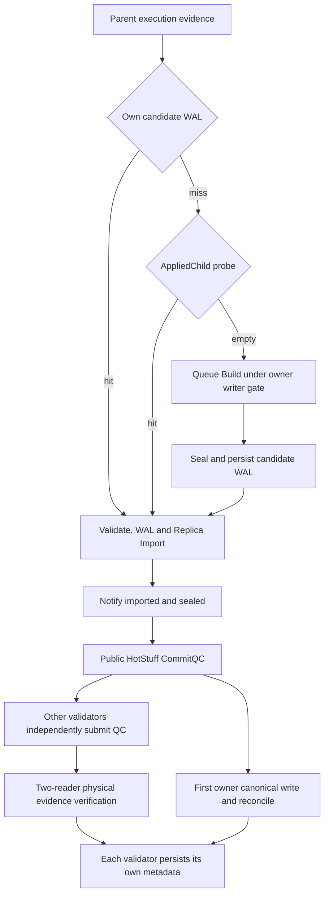

# Independent Unix single-block profiling

This diagnostic has passed its controlled source validation. It changes no production behavior and
opens neither the retained chain nor the original supply corpus. The q6 window
remains failed; its 489,000 canonical transactions over 20.007302757 seconds
are diagnostic, without accepted throughput or capacity evidence.

`TestUnix163kOperationProfile` is opt-in through `GOV5_UNIX_PROFILE_DIR`, which
must name a fresh absolute output directory. A controlled source-only claim
must admit at least 90 GiB of available memory and maintain an 80 GiB runtime
floor. Signing, setup and validation use GOMAXPROCS=2; each explicitly measured
operation temporarily uses 36 and records the actual transition and restore.
Compilation and the normal/race/vet/Make checks continue at `go -p 1` and
GOMAXPROCS=2. Execution must follow the current retained-chain audit's terminal
cleanup; this file does not authorize a concurrent worker.

The synthetic chain has 6,000 funded senders and 22,857 recipient accounts
precreated with balance one. Recipient addresses use the existing corpus
recipient rule. All sender/recipient/validator addresses must be disjoint.
Each sender signs 28 protected EIP155 transfers. The 64-shard, 28-transaction
frames undergo actual strict signature admission before profiling starts.
This reproduces the owner block and sender-lane geometry, not the production
500-transaction resume protocol or source throughput.

The queue starts with 168,000 transactions. The real Unix BuildFromQueue RPC
selects 163,000 under the existing 32 MiB body limit: 27 complete rounds over
address-sorted senders, then the first 1,000 senders' next transaction. The
expected ordered hashes are computed from the signed input before selection.
An external test leader seals the result. Real Unix Import, AppliedChild,
one first certified commit and six concurrent certified duplicates follow.
Each commit request still supplies a public five-of-seven CommitQC; a
four-vote request must be rejected. This is certificate verification, not a
seven-process consensus-network measurement.

The default strict-import path and the existing own-build-reuse path share
exactly the same genesis, signing keys, signed bytes and manifest. Each runs
against its own fresh durable MDBX database with no synchronization override;
the test uses an explicit 8 GiB mapping and 256 MiB growth step. It does not
use `memdb`, whose options include UtterlyNoSync, for either measured chain.
Auxiliary genesis calculation may use the existing in-memory helper outside
measured intervals. Both databases and profiling
outputs remain under the owned artifact directory.

Each operation saves its CPU profile, cumulative allocation profiles before
and after, elapsed monotonic wall time, allocation-byte delta and malloc delta.
Use the allocation-before profile as `pprof -base` when interpreting the after
profile. CPU samples cover client and server work in the same Go process;
they do not include key generation, signing or admission. GC and profiler
startup/flush occur outside each recorded operation wall interval. The
explicit GC between operations changes cache/GC conditions compared with a
continuous production run, so these samples locate stacks rather than predict
sustained throughput. Nested production phase records overlap the outer RPC
intervals and must not be added as independent wall or CPU totals.

The build records whether a prepared candidate exists and its retained bytes.
The strict path must perform two actual execution attempts (build and import),
and the reuse path one. A prepared-candidate budget miss preserves failure;
the existing 128 MiB cap is not enlarged. The CPU profiler is flushed through a
defer even when an operation exits abnormally. Storage override environment
variables are rejected, and actual MDBX flags must exclude reduced-sync and
write-map modes.

Final checks run outside the profiles: exact gas and receipt roots/bloom,
all physical transaction lookups, canonical/applied marker equality,
root-bound Unix account reads for every sender and recipient, each sender's
nonce/balance and recipient credits, 5,000 pending transactions, zero reserved
credits and unchanged duplicate generation. Both modes must produce the same
sealed block hash, genesis/manifest hashes, actual root, receipts, gas and
complete account-vector digest. Successful
output remains explicitly `tps_measured=false`.

The purpose is to choose a measured architectural change. Q6's ten 163,000-tx
blocks spent roughly 1.7 seconds in queue Build RPC, about one second in
Replica Import and several seconds around owner read/commit serialization,
while strict EVM execution itself was about 14–22 ms. The proposed ViewID proof
sharing could remove duplicate physical scans, but its idealized critical-path
gain is much smaller than the historical throughput gap. No cache or next
retained-chain load is introduced by this diagnostic.

The preceding retained-chain audit has independently passed: v6 status
`f6fc5d87`, result `6c835e80`, acceptance `2f161c26`. Both physical reopens
confirm height 1431, canonical count 7,570,852 and root `8cb442c2…`, with all
runtime processes and claims released. Its original database is now 4 GiB;
this diagnostic does not open that database or reinterpret q6's failed window.

## Actual source validation

The unique batch passed all five stages: the actual two-mode profile (59.168s),
32 local CPU/allocation reports (3.255s), targeted race regression (37.642s),
vet (3.794s) and Make build (143.832s). All six controller/stage process groups
and owned claim identities were released. The accepted test and original doc
bytes are preserved in commit `03f57aed82594149297ebb016b8906425adcce2c`;
this follow-up changes only documentation and needs no repeat Go run.

Evidence is under
`/data/blockchain/gov5-work/validation/20261018-gov5-unix-163k-profile-v1`:

| Artifact | SHA-256 |
| --- | --- |
| `status.json` | `3bbc261a15ba9435214f968442f85475d4941aa77239d4c98c555c8adb5aac3e` |
| `acceptance.json` | `fd1b676a2d7da94e25cef4d2cde6122035d070b46996b283588056296f16f527` |
| `profiles/profile-result.json` | `d23d809af9a06193f4c47ce631aac843d7c16586d8ac921a261cb0d9431d056e` |
| `profiles/profile-reports.json` | `badbb70932b966622eb212c5bf667a8053ccbf61c232ba20c87b0b71598d582f` |

The fixed independent verifier `2e08d185…` accepted 101 evidence hashes;
independent read-only replay reproduced the existing acceptance. Both modes
produced sealed block `0x2ebf7067…`, root `0x4b9a094e…` and complete account
vector digest `0xf77fb407…`, with exactly 163,000 canonical transactions and
5,000 pending. The strict mode executed twice; reuse executed once and held
a 106,713,401-byte prepared candidate, within the unchanged 128 MiB cap.

The following are separate operation intervals in this fixture. CPU seconds
sum sampled CPU work across Go threads; allocation is a MemStats delta in MiB.
They are not sustained throughput measurements or additive production latency.

| Operation | Strict wall ms | Strict CPU s | Strict allocated MiB | Reuse wall ms | Reuse CPU s | Reuse allocated MiB |
| --- | ---: | ---: | ---: | ---: | ---: | ---: |
| Queue Build RPC | 1260.850 | 8.08 | 1401.042 | 1082.006 | 3.17 | 1292.370 |
| Import RPC | 841.392 | 2.66 | 981.780 | 720.831 | 1.18 | 892.102 |
| AppliedChild hit RPC | 529.591 | 0.86 | 740.882 | 513.713 | 0.81 | 733.509 |
| First certified commit | 722.986 | 5.45 | 477.772 | 777.866 | 5.47 | 472.996 |
| Six duplicate commit RPCs, concurrent wave | 864.895 | 2.29 | 1067.832 | 811.377 | 2.07 | 1045.939 |

This is not a fair cold-state A/B test. The modes run in one process with
identical transaction hashes, strict first, so its execution warms the global
sender cache. Strict Build sampled 4.97 CPU-seconds in recoverBlockSenders
workers; reuse Build sampled only about 0.09 there. Build happens before reuse
can take effect. Consequently the Build difference cannot be attributed to the
reuse flag, and the Import difference is descriptive rather than a causal
speedup estimate. A future causal comparison would require separate processes
with the same fixed initial input, but another profiling turn is not scheduled.

The stack evidence supports several costs rather than a single CPU bottleneck:

- Strict Build used 8.08 CPU-seconds over 1.261 seconds of wall time. Sender
  recovery dominated sampled CPU; RLP encodeString allocated about 296 MiB,
  and transaction decoding about 230 MiB cumulatively. These allocation counts
  cannot establish serialization's wall contribution on their own.
- The first commit's direct canonical sender recovery took about 303–305 ms
  wall time with the existing 16-worker cap. It remained even with own-build
  reuse. About 187 ms of durable evidence and 114 ms of canonical work were
  additional phases in the strict fixture. CPU and nested timings overlap.
- A six-duplicate wave retained independent QC checks and two-reader admission.
  Its strict CPU profile included 1.72 seconds cumulatively in certified
  execution verification: checked receipts about 0.75, physical lookup GetOne
  about 0.40 and stored block reading about 0.38. These are nested sampled CPU
  groups, not six independent wall intervals to sum.

## Actual dependency paths

Fresh construction and recovery are alternative paths, followed by a common
publication tail. The fixture's AppliedChild sample is a **hit after import**;
fresh production probes before Build and normally expects an empty result.

Replica Import includes local body/root/availability checks, owner full Import
or ImportRef, and local execution evidence. The first owner commit validates
the QC and physical evidence, writes canonical/finality metadata, performs
signed canonical sender recovery and reconciles ingress under its writer gate.
Already-canonical requests use the probe, bounded read slots, fresh QC and
body/receipt/physical-index verification, queue-stamp check and final durability
read. Next-leader work can overlap those requests while competing for owner
and chain locks. Do not add these wall times to manufacture a critical path.

The frozen q6 production logs make that contention concrete: 48 owner
AppliedChild records total 16.119 seconds, of which 15.636 seconds (97.0%) are
execute-gate waiting; stored read, durable checks and marshaling together are
only about 0.483 seconds. Thus a 1.4–2.0 second production probe is not explained
by this fixture's 0.53-second hit workload. The q6 phase analysis is
`diagnostic-phase-analysis-v2.json`, SHA
`f6b71b4e329e167f245c890b70c47093c5351f4ef96c00a1d6a9f9b48cf3f4ed`.

## Next design boundary; no implementation or new load

Pause production patches, isolated duplicate caches and q7. The next single
design object is the boundary between **stored block materialization checked
in one physical snapshot** and **each validator's independent authorization
and progress**. This is an architectural contract to review, not an implemented
optimization or a claim of a 30-fold gain.

The proposed private materialization is bounded and immutable. Its identity
must include chain/database instance lifetime, actual supported read-only MDBX
ViewID, sealed block hash, immutable configuration digest and the exact evidence
kind required by the consumer. A hit is eligible
only inside a current read snapshot with exactly that identity; every DB write,
reopen, instance replacement or configuration change invalidates eligibility.
Zero/unknown ViewID, unsupported wrappers, layered/tiered storage or evidence
outside the same hot MDBX snapshot use the existing path. In particular an
ancient-file read is not automatically authenticated by the hot DB's ViewID.

The materializer must prove the following from actual storage before publishing
anything reusable:

1. Header identity, number, parent and sealed hash bind the requested block.
   Header hash alone does not prove stored body integrity: explicitly verify
   the stored transaction body against its header transaction root.
2. Receipt count/type and derived root, gas and bloom agree with that header;
   sender/receipt I/O errors and malformed data propagate. Canonical duplicate
   evidence additionally verifies every actual physical transaction lookup
   entry and height, with no resolver shortcut. An applied, not-yet-canonical
   child may legitimately have no canonical lookup entries; that weaker
   materialization must never satisfy the canonical-indexed evidence kind.
3. Copy owned immutable output only after the entire snapshot check succeeds.
   Publish neither errors, false results nor partial materializations as hits.
   Do not retain a mutable decoded block/receipt graph or a transferable
   authorization report. Bound entry count, total retained bytes and in-flight
   decoding separately; an oversized entry misses rather than raising a cap.

Every certified commit consumer still freshly binds its request and validates
its own complete five-of-seven CommitQC domain/view/signers/seal. An AppliedChild
consumer instead retains the existing sealed-header, requested parent/height/
proposal-view and actual applied-lineage checks; it does not require a new QC
before reproposing the child. Current canonical, finalized
and applied lineage markers, owner queue stamp/clean state and final durability
read remain request-specific. Validator local body availability and metadata
durability remain independent. Canonical writes and ingress reconciliation
remain single-writer; canonical sender recovery is not replaced by an ingress
mapping, sender hint or process cache. An in-memory materialization by itself
does not establish durability.

The lifecycle/locking design must be resolved before implementation:

- Lookups and worker coordination cannot hold queue locks over DB/BLS work.
  Define owner/chain read guards, materialization-worker ownership, cancellation
  and Close joining without a read-to-write lock upgrade. A repair fallback
  releases read ownership and revalidates everything under the old writer path.
- AppliedChild currently calls joinLagWrite, which can perform recovery work.
  It cannot be moved out of the writer gate by merely changing Lock to RLock.
  A new read-only route must prove no pending lag write and a consistent actual
  applied lineage; otherwise it falls back. Mutable in-memory QMDB roots are
  not certified solely by a database snapshot ID.
- Specify the treatment of transient I/O failures on otherwise identical
  snapshots, shared-worker cancellation and bounded waiting. Sharing checked
  physical data must not silently turn the current fresh-read error contract
  into unconditional success. This remains an explicit review question.
- A same-block source check must retain fresh QC verification for each caller
  while demonstrating one eligible physical materialization; adjacent-block
  writes and controlled damage must force a miss or reject. Also cover backend
  fallback, bounded memory, wrong QC, marker/queue changes, writer exclusion,
  owner shutdown and unchanged physical-reopen validation.

Even ideal six-to-one duplicate scan sharing was estimated to remove only
about 0.6–0.9 seconds from a production block's contested path. A one-second
serial Build and a roughly 0.3-second canonical sender recovery are already
incompatible with 163,000 transactions every 0.212 seconds. The historical
roughly 770k TPS result also used a different execution/network profile and
60-second RPC block-count measurement, without the same provenance and full
reopen evidence. It is not an accepted capacity guarantee for this owner
pipeline. No current result demonstrates sustained 5M TPS.
